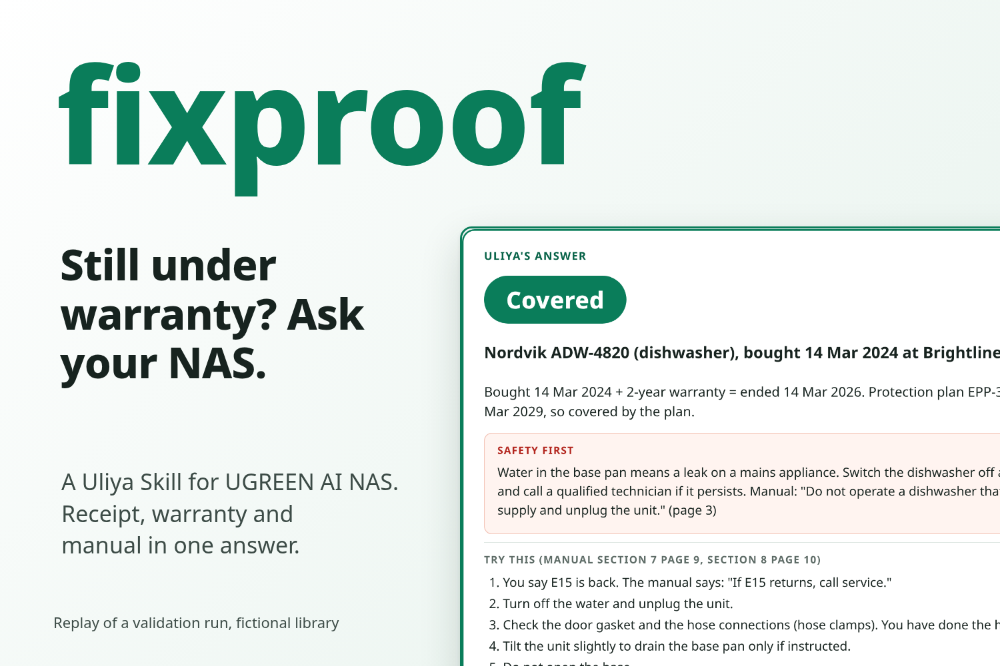
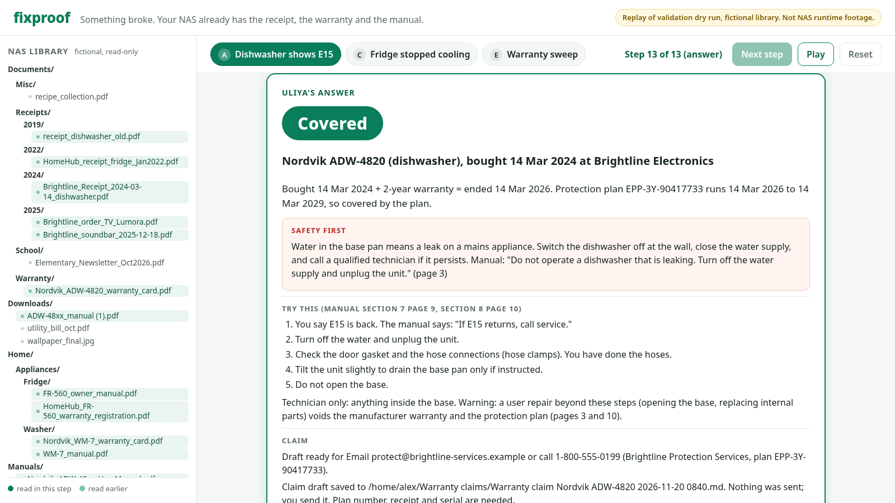

# fixproof

Something broke. Your NAS already has the receipt, the warranty and the manual. fixproof is a Skill for Uliya, the assistant on UGREEN AI NAS, that turns those files into a coverage answer, the manual's fix and a ready claim.



Demo video: {{video_url}}

## What it does

Say "The dishwasher is doing this again." next to a photo of the blinking E15 display, and fixproof:

- reads the error code and brand from the photo, then finds the receipt, whether it is a PDF or a phone photo of paper;
- picks the right unit when there are two (a 2019 and a 2024 dishwasher) by matching the serial on the rating-plate photo;
- reads the warranty card and the protection plan, computes each end date and says Covered, Not covered or Unclear, with the reason;
- returns only the manual's rows for that error code, safety warning first;
- drafts the claim with plan number, serial and contact, and saves it to the NAS only after you say yes.

A second mode answers "Which warranties run out in the next three months?" and totals the purchase value about to lose cover. The skill never deletes, moves or sends anything, and every fact in the answer names the file it came from.

## Try it

- **On a UGREEN AI NAS:** upload [`dist/fixproof.zip`](dist/fixproof.zip) as a Uliya Skill. Copy `testdata/home-library/` to your home folder, then ask Uliya "My dishwasher is leaking and showing E15." or "Which warranties run out in the next three months?"
- **Without a NAS (30 seconds):** open `walkthrough/index.html` in a browser after one build step. It replays three recorded validation runs step by step: which agent was asked what, what it found, and which files in the library it read.

      python3 walkthrough/build.py
      python3 -m http.server 8000 -d walkthrough    # open http://127.0.0.1:8000/

  

  Scenarios: A (dishwasher E15, covered by the plan, claim saved), C (fridge serial off by one digit, Unclear), E (warranty sweep).

## How it works

```
user + photo ──> fixproof (SKILL.md)
                   │ 0. photo-agent     error code, brand, time of the panel photo
                   │ 1. file-agent      receipts by name; photo-agent for photographed receipts
                   │ 2. document-agent  purchase date, store, model, serial, plan line
                   │ 3. file-agent      warranty card and plan terms for that model
                   │    document-agent  term, parts covered, exclusions, claim contact
                   │ 4. rules           end dates, verdict, serial cross-check (references/coverage-rules.md)
                   │ 5. file-agent      manual for the model series; sha256 to drop duplicates
                   │    document-agent  rows for this error code, safety text
                   └ 6. knowledge-agent save the claim draft, only after "yes"
```

The skill is plain Markdown: `fixproof/SKILL.md` holds the steps and the exact instruction sent to each expert agent, and `fixproof/references/` holds the coverage rules, the answer format, worked examples, the user guide and the disclosure. File search matches names, so document-agent confirms the content before a file is trusted. When two documents disagree, the answer reports the conflict instead of picking one.

## Validation

No NAS was available while building it, so the skill was tested as a tabletop run against `testdata/home-library/`, a fictional 28-file family library with deliberate traps: a decoy 2019 dishwasher receipt, a washer receipt that exists only as a phone photo, a duplicate manual in Downloads, a TV with no manual, and a fridge whose registered serial differs from its rating plate by one digit. Each expert was played from the real files (pdftotext, the images and their EXIF dates, file-name matching, sha256sum). The final run passed 8 of 8 scenarios with 65 delegations. Results and transcripts are in [`validation/RESULTS.md`](validation/RESULTS.md); the expected answers are in [`testdata/README.md`](testdata/README.md).

## Built with

Uliya Skill format (SKILL.md), UGREEN AI NAS expert agents (photo-agent, file-agent, document-agent, knowledge-agent), Markdown, Python (checker, packager, test library generator), HTML and JavaScript (walkthrough).

## License

MIT, see [LICENSE](LICENSE).

---

## Developer notes

| Path | What |
|---|---|
| `fixproof/` | The Skill package. This folder is what gets zipped and installed. |
| `dist/fixproof.zip` | The packaged Skill. |
| `testdata/` | The fictional library, its generator and the expected answer for each scenario. |
| `validation/` | Results table and the eight dry-run transcripts. |
| `walkthrough/` | Static replay of three dry runs, its data test and a headless browser check. |
| `tools/` | Package checker and zip builder (Python 3.10+, no dependencies). |

Check and package:

    python3 tools/check_skill.py fixproof
    python3 tools/package_skill.py fixproof dist/fixproof.zip

Optional official check with the UGREEN Skill Developer Package (uliya-skill-kit 0.7.3, Node 18+), downloaded from the hackathon resources page and unzipped next to this repo. It reports `"status": "static-pass"` with 0 errors and 0 warnings:

    node ../uliya-skill-kit/scripts/check-skill.mjs fixproof

Walkthrough tests (the browser check needs Playwright and Chromium):

    python3 walkthrough/test_build.py
    python3 walkthrough/e2e_check.py screenshots/

Regenerate the test library (needs reportlab, Pillow, numpy; the output is byte-identical on each run):

    python3 testdata/make_library.py
